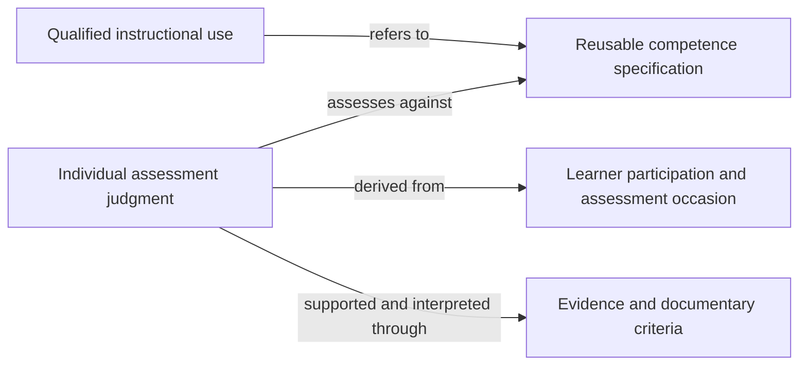

# OntoKSD

<p align="center"></p>

**Reusable competence specifications, contextual instructional uses, and traceable assessment judgments in Computing Education.**

A competence can be addressed in several activities, while each use has its own purpose and conditions. An assessment judgment adds another question: what evidence and criteria support the interpretation about this learner? **OntoKSD connects these records while keeping their meanings distinct.**

OntoKSD is a domain ontology formalized in OWL 2. It gives competence specifications a reusable identity and relates them to curricular references, instructional units, assessment participation, evidence, and proficiency schemes. Its Knowledge–Skill–Disposition perspective accommodates several curricular formulations.

[Português](README.pt.md) · [Try the example](docs/quickstart.md) · [Model](docs/model.md) · [Cases](docs/use-cases.md) · [Evaluation](docs/evaluation.md)

[Published ontology](http://purl.org/ontoksd) · [Archived deposit](https://doi.org/10.5281/zenodo.24210697) · [Research paper](https://doi.org/10.5753/sbie.2026.27784)

## What you can do with OntoKSD

| Need | OntoKSD mechanism | Explore |
| --- | --- | --- |
| Reuse a specification across activities | Separate competence identity from qualified instructional associations. | [Contextual reuse](docs/use-cases.md#reuse-one-specification-across-activities) |
| Make expected performance explicit | Organize knowledge, skills or knowledge–level pairings, dispositions, and reference tasks through specification patterns. | [Specification model](docs/model.md) |
| Inspect the basis of an individual judgment | Connect the assessed specification, learner participation, assessment occasion, evidence, and documentary criteria. | [Task202 case](docs/use-cases.md#trace-a-recorded-judgment-to-its-documentary-basis) |
| Preserve the meaning of a proficiency attribution | Identify scores, categories, and interpretation schemes separately. | [Proficiency example](proficiency%20level/README.md) |
| Explain a curricular correspondence | Record the expectations related, relationship type, scope, and justification. | [Programming dataset](competenceInstances/CSP/cycle-04/README.md) |

The ontology is relevant to educators and curriculum designers documenting expectations, researchers examining competence models, and developers connecting instructional and assessment information.

## The distinction behind the model



These are conceptual connections, not a temporal sequence or automatic derivation of attainment. A specification can be reused while its instructional contribution and assessment records remain independently inspectable.

## Try a complete, small example

No GraphDB server is needed for the local demonstration:

```bash
git clone https://github.com/eduknowgpt/OntoKSD.git
cd OntoKSD
python -m pip install -r examples/quickstart/requirements.txt
python examples/quickstart/run.py
```

The **fictional** example retrieves two constituents of one specification, its use in two instructional activities, and two evidence records supporting one judgment. These records represent a written explanation and an oral-explanation observation. The queries recover their criterion and source rubric.

[Files, expected results, and environment setup](docs/quickstart.md). This illustrates representation and retrieval; it is not a study of oral assessment or AI-assisted student work.

## Explore the research artifacts

| Material | Entry point |
| --- | --- |
| OWL ontology and local imports | [Ontology package](ontoKSDOntology/README.md) |
| Framework-specific levels and action verbs | [Vocabulary](bloomTaxonomy/README.md) |
| Curricular and CSP-derived examples | [Instance guide](competenceInstances/README.md) |
| 42 CQ families: 57 SELECT queries and one optional update | [Query collection](sparql/CQ/README.md) |
| Read-only CQ1 desktop explorer | [CQ1 Explorer](sparql/CQ/viewer/README.md) |
| GraphDB loading | [Loader guide](loadInGraphDB/README.md) |
| Moodle projection examples | [Moodle guide](MOODLE/README.md) |
| RCD exchange representation and shapes | [RCD profile](rcd/README.md) |

Built-in patterns cover KS, KSA, CC2020-oriented, and CS2023-oriented arrangements. An IS2020 dataset additionally illustrates a custom pattern value using the existing mechanism; its guide documents that interpretation.

[Full repository map](docs/repository-guide.md)

## Evidence you can inspect

- **Archived GraphDB batch:** 57 SELECT queries completed; 54 returned rows and three returned zero rows. Raw results, fingerprints, and provenance notes are preserved.
- **Offline regression:** selected retrieval, missing-information, prerequisite, and proficiency behaviors are checked against explicit expectations using RDFLib.
- **Retrospective judgment traceability:** the Task202 supplement links one C05 judgment to two criteria and three supporting documents.
- **Publication checks:** the archived FOOPS! report records **24 of 24 checks passed**.

[Evaluation guide](docs/evaluation.md) distinguishes execution, expected-result checks, source inspection, and publication metadata. These results support the cases and conditions examined; they do not establish comparative superiority or educational effectiveness.

## CSP and OntoKSD

The [Competency Specification Process (CSP)](https://github.com/eduknowgpt/OCSP) organizes formulation, review, and maintenance decisions. **OntoKSD represents selected specification content and its educational relationships.** Their connection provides a path from documented specification problems to representational requirements.

## Version, reuse, and citation

- **Documented version:** 7.0.0, identified by `owl:versionIRI`; the filename retains `v7.0`.
- **Main artifact:** [OntoKSD — SKOS — v7.0.ttl](ontoKSDOntology/OntoKSD%20-%20SKOS%20-%20v7.0.ttl).
- **Namespace:** `http://purl.org/ontoksd#`.
- **Main ontology license:** [CC BY 4.0](https://creativecommons.org/licenses/by/4.0/), as declared in its metadata. Imported resources and curricular content retain their own conditions.

A related publication presents the semantic model:

```bibtex
@inproceedings{Edeyson2026OKSD,
  author    = {Gomes, Edeyson and Salvador, Laís and Cerqueira, Marcos},
  title     = {{OntoKSD}: A Semantic Model for Competence Traceability in Computing Education},
  booktitle = {Anais do XXXVII Simpósio Brasileiro de Informática na Educação},
  year      = {2026},
  pages     = {1317--1331},
  publisher = {SBC},
  doi       = {10.5753/sbie.2026.27784},
  url       = {https://sol.sbc.org.br/index.php/sbie/article/view/45693}
}
```

Also identify the version, commit or archived release, dataset, and configuration used in your work. For questions, examples, or reproducible issue reports, use [GitHub Issues](https://github.com/eduknowgpt/OntoKSD/issues).
