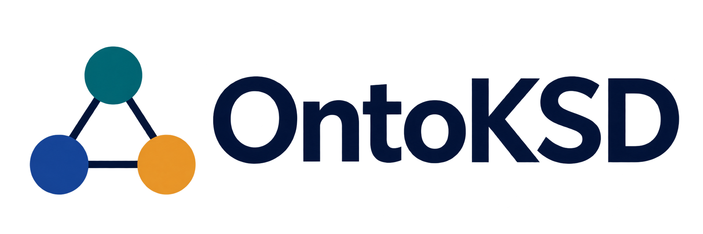

# OntoKSD

<p align="center"></p>

**Especificações reutilizáveis de competências, usos instrucionais contextualizados e julgamentos de avaliação rastreáveis em Educação em Computação.**

Uma competência pode ser abordada em várias atividades, cada uma com finalidades e condições próprias. Um julgamento de avaliação acrescenta outra pergunta: quais evidências e critérios sustentam a interpretação sobre este estudante? **A OntoKSD conecta esses registros e preserva suas diferenças de significado.**

A OntoKSD é uma ontologia de domínio formalizada em OWL 2. Ela atribui identidade reutilizável às especificações de competências e as relaciona a referenciais curriculares, unidades instrucionais, participação em avaliações, evidências e esquemas de proficiência. Sua perspectiva Conhecimentos–Habilidades–Disposições acomoda diferentes formulações curriculares.

[English](README.md) · [Experimente](docs/quickstart.md) · [Modelo](docs/model.md) · [Casos](docs/use-cases.md) · [Avaliação](docs/evaluation.md)

[Ontologia publicada](http://purl.org/ontoksd) · [Depósito arquivado](https://doi.org/10.5281/zenodo.24210697) · [Artigo](https://doi.org/10.5753/sbie.2026.27784)

## O que a OntoKSD permite fazer

| Necessidade | Mecanismo | Onde explorar |
| --- | --- | --- |
| Reutilizar uma especificação | Separação entre identidade da competência e associações instrucionais qualificadas. | [Reúso contextual](docs/use-cases.md#reuse-one-specification-across-activities) |
| Explicitar o desempenho esperado | Conhecimentos, habilidades ou pares conhecimento–nível, disposições e tarefas de referência. | [Modelo](docs/model.md) |
| Examinar um julgamento individual | Conexões entre especificação avaliada, participação, ocasião, evidências e critérios. | [Caso Task202](docs/use-cases.md#trace-a-recorded-judgment-to-its-documentary-basis) |
| Interpretar uma atribuição de proficiência | Identificação separada de notas, categorias e esquemas interpretativos. | [Proficiência](proficiency%20level/README.md) |
| Explicar uma correspondência curricular | Registro das expectativas relacionadas, tipo de relação, escopo e justificativa. | [Programação introdutória](competenceInstances/CSP/cycle-04/README.md) |

O projeto interessa a educadores e equipes curriculares que documentam expectativas, pesquisadores que examinam modelos de competências e desenvolvedores que conectam informações instrucionais e avaliativas.

## A distinção central

A **especificação** descreve o desempenho esperado. O **uso instrucional** registra como essa expectativa contribui para uma atividade. O **julgamento individual** registra uma interpretação apoiada em participação, evidências e critérios.

A mesma especificação pode ser reutilizada enquanto seus usos e registros de avaliação permanecem identificáveis. Representar essas conexões não produz automaticamente um julgamento sobre a aprendizagem.

## Experimente um exemplo completo

A demonstração local não exige servidor GraphDB:

```bash
git clone https://github.com/eduknowgpt/OntoKSD.git
cd OntoKSD
python -m pip install -r examples/quickstart/requirements.txt
python examples/quickstart/run.py
```

O exemplo **fictício** recupera dois constituintes de uma especificação, seus usos em duas atividades e dois registros de evidência que sustentam um julgamento. As evidências representam uma explicação escrita e um registro de observação de explicação oral. As consultas recuperam o critério e o barema de origem.

[Arquivos, resultados esperados e preparação do ambiente](docs/quickstart.md). A demonstração não constitui estudo de avaliação oral ou de trabalhos produzidos com assistência de IA. Os guias técnicos estão em inglês.

## Explore os materiais

| Material | Entrada |
| --- | --- |
| Ontologia OWL e importações locais | [Pacote da ontologia](ontoKSDOntology/README.md) |
| Níveis cognitivos e vocabulário de verbos | [Vocabulário](bloomTaxonomy/README.md) |
| Exemplos curriculares e derivados do CSP | [Guia das instâncias](competenceInstances/README.md) |
| 42 famílias de questões: 57 SELECT e uma atualização opcional | [Consultas](sparql/CQ/README.md) |
| Interface CQ1 somente para leitura | [CQ1 Explorer](sparql/CQ/viewer/README.md) |
| Carregamento no GraphDB | [Carregador](loadInGraphDB/README.md) |
| Projeção no Moodle | [Moodle](MOODLE/README.md) |
| Intercâmbio RCD e shapes | [Perfil RCD](rcd/README.md) |

Os padrões incorporados contemplam KS, KSA e formulações orientadas ao CC2020 e ao CS2023. O conjunto IS2020 também exemplifica um valor de padrão próprio, com interpretação e verificações documentadas em seu guia.

## Evidências disponíveis

- **Execução arquivada no GraphDB:** 57 SELECT concluídas; 54 retornaram linhas e três retornaram zero linhas, com resultados e proveniência preservados.
- **Regressão local:** comportamentos selecionados de recuperação, informações ausentes, pré-requisitos e proficiência são comparados com expectativas explícitas usando RDFLib.
- **Rastreabilidade retrospectiva:** o suplemento Task202 conecta um julgamento de C05 a dois critérios e três documentos de suporte.
- **Publicação orientada a FAIR:** o relatório FOOPS! arquivado registra aprovação em **24 de 24 verificações**.

O [guia de avaliação](docs/evaluation.md) explica o alcance dessas evidências. Os resultados sustentam os casos e condições examinados, sem estabelecer superioridade comparativa ou eficácia educacional.

## CSP e OntoKSD

O [Processo de Especificação de Competências — CSP](https://github.com/eduknowgpt/OCSP) organiza formulação, revisão e manutenção. **A OntoKSD representa informações selecionadas das especificações e suas relações educacionais.** Essa articulação conecta problemas documentados a requisitos representacionais.

## Versão, reúso e citação

- **Versão documentada:** 7.0.0, identificada por `owl:versionIRI`; o nome do arquivo mantém `v7.0`.
- **Artefato principal:** [OntoKSD — SKOS — v7.0.ttl](ontoKSDOntology/OntoKSD%20-%20SKOS%20-%20v7.0.ttl).
- **Namespace:** `http://purl.org/ontoksd#`.
- **Licença da ontologia principal:** [CC BY 4.0](https://creativecommons.org/licenses/by/4.0/), conforme seus metadados. Recursos importados e conteúdos curriculares mantêm suas próprias condições.

Cite o [artigo da OntoKSD](https://doi.org/10.5753/sbie.2026.27784) e identifique versão, commit ou depósito, dados e configuração utilizados. A [página em inglês](README.md#version-reuse-and-citation) apresenta a entrada BibTeX.

Dúvidas e relatos reproduzíveis de problemas: [GitHub Issues](https://github.com/eduknowgpt/OntoKSD/issues).
